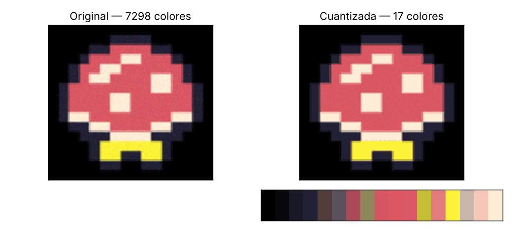
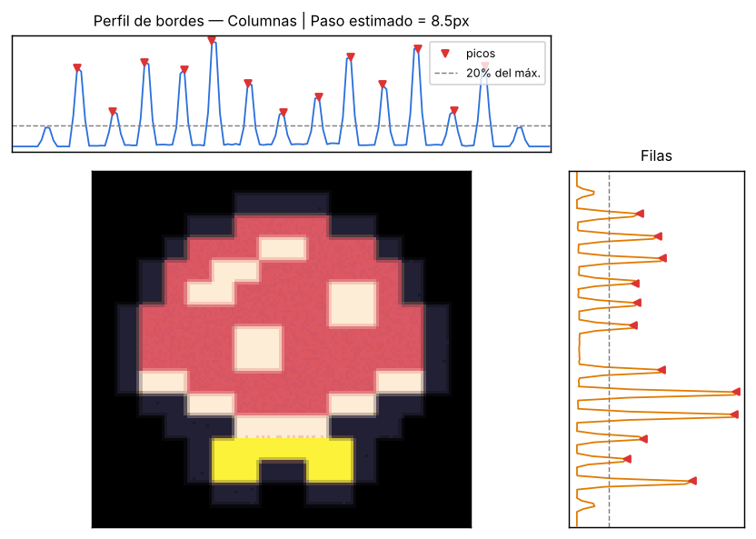
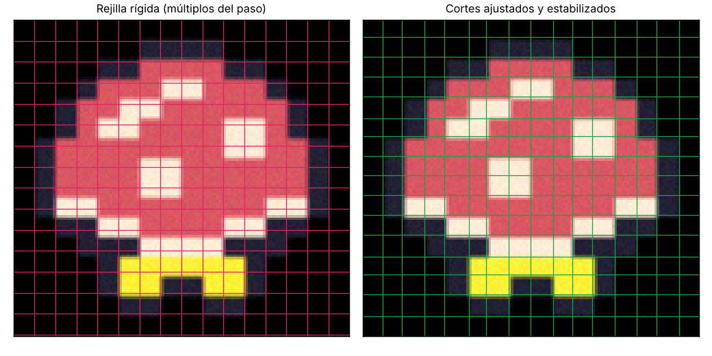
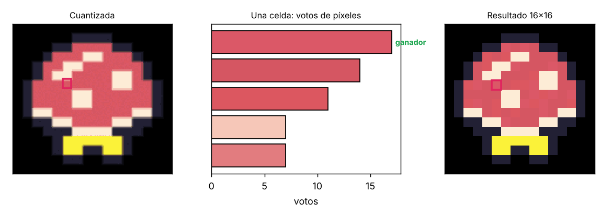
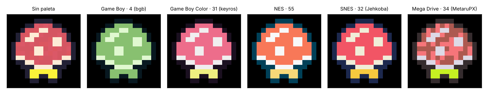

# Pixel Snapper Web

[English](README.md)

Versión web de [spritefusion-pixel-snapper](https://github.com/Hugo-Dz/spritefusion-pixel-snapper). Corrige pixel art desordenado generado por IA: detecta su rejilla real de píxeles, reduce sus colores y lo ajusta a esa rejilla. Todo se ejecuta en el navegador y no se sube nada.

- Interfaz en inglés y español (inglés por defecto)
- Tamaño de píxel automático o manual, y cantidad de colores (k-means)
- Paletas predefinidas: Game Boy, Game Boy Color, NES, SNES y Mega Drive, además de importar un PNG o una lista de colores hex
- Exportación a PNG en 1x, 4x, 8x o 16x

## Uso

Abre `index.html` o sirve la carpeta con cualquier servidor estático. Es un único archivo autocontenido.

## Cómo funciona el algoritmo

El "pixel art" generado por IA parece pixel art, pero sus píxeles están borrosos, tienen tamaños algo distintos y no están alineados, y los colores varían. Pixel Snapper recupera la rejilla que la imagen debía tener. El código está en `src/core.js` y sigue paso a paso el original en Rust.

**1. Cuantizar los colores.** Los valores RGB de todos los píxeles no transparentes se agrupan con k-means++ (semilla fija, hasta 15 iteraciones) en la cantidad de colores que elijas. Cada píxel se reemplaza por el color de su grupo más cercano. Así se eliminan el ruido y los degradados y los bordes quedan limpios. Los píxeles transparentes se ignoran.



**2. Construir perfiles de bordes.** La imagen cuantizada se pasa a escala de grises. Para cada columna se suma, en todas las filas, el gradiente horizontal `|g(x+1) - g(x-1)|`, lo que da un número por columna. Lo mismo se hace por filas. Las columnas y filas donde muchos píxeles cambian de color a la vez tienen valores altos, así que los picos marcan los bordes entre píxeles del sprite.



**3. Estimar el tamaño de píxel.** En cada eje, los máximos locales por encima del 20% del valor más alto se toman como picos, y se descartan los picos a menos de 4 px de otro. El tamaño de píxel es la mediana de la distancia entre picos consecutivos. Luego se combinan los dos ejes:
- si indicas un tamaño manual, se usa tal cual;
- si ambos ejes encontraron un tamaño y difieren en más de 1,8 veces, se usa el menor para los dos;
- si son parecidos, se usa su promedio;
- si solo un eje encontró un tamaño, se usa para ambos;
- si ninguno lo encontró, se usa `min(ancho, alto) / 64`.

**4. Recorrer las líneas de la rejilla.** Desde 0, un caminante elástico avanza un tamaño de píxel y busca en una ventana alrededor de ese punto (35% del paso, mínimo 2 px). Si el borde más fuerte de la ventana supera la mitad del valor medio del perfil, el corte se coloca en ese borde. Si no, se coloca en la posición esperada. Cada corte reubica al caminante, así que la rejilla sigue a las imágenes con píxeles algo irregulares en vez de imponer una rejilla rígida.



**5. Estabilizar ambos ejes.** Si un eje quedó con muy pocos cortes (menos de 4), o su tamaño de celda difiere más de 1,8 veces del otro eje, sus cortes se reconstruyen como una rejilla uniforme con el paso del otro eje, ajustando cada línea al borde más fuerte cercano. Una comprobación final compara los tamaños de celda de ambos ejes y, si no coinciden, rehace el más grueso con el paso más fino.

**6. Remuestrear.** Cada celda entre dos cortes verticales y horizontales consecutivos se convierte en un píxel de salida. Su color es el más frecuente dentro de la celda (en empates gana el menor valor RGBA). El tamaño de salida es el número de celdas, así que un sprite dibujado a 16x16 vuelve a ser de 16x16.



**7. Paleta opcional.** Si eliges o importas una paleta, cada color de salida se reemplaza por el color más cercano de la paleta (distancia euclídea en RGB). La transparencia se conserva.



### Límites y consejos

- Las imágenes deben medir entre 3x3 y 10000x10000 px. Un tamaño de píxel manual debe estar entre 1 y la mitad del lado menor.
- Esta app acepta hasta 6 megapíxeles para no ponerse lenta en el móvil.
- La detección automática depende de los bordes. Las imágenes con zonas planas grandes pueden dar un tamaño de píxel incorrecto. Si el resultado se ve mal, desactiva "Detectar automáticamente" y escribe el tamaño de píxel.
- k-means usa otro generador aleatorio que la versión en Rust, así que las imágenes con ruido pueden diferir un poco de la herramienta original. En imágenes con pocos colores exactos el resultado es idéntico píxel a píxel.

## Desarrollo

Los fuentes están en `src/` (`core.js` es el algoritmo, `app.js` la interfaz). Regenera el archivo único con:

```
python3 build.py
```

## Créditos

El algoritmo es un port a JavaScript del código en Rust de
[Hugo-Dz/spritefusion-pixel-snapper](https://github.com/Hugo-Dz/spritefusion-pixel-snapper) (MIT).
Los colores de las paletas vienen de paletas de [Lospec](https://lospec.com/palette-list).

## Licencia

Este proyecto está bajo GPL-3.0 (ver `LICENSE`). Incluye un port de código con licencia MIT; el aviso
original de copyright y permiso se conserva en `LICENSE-UPSTREAM-MIT`.
